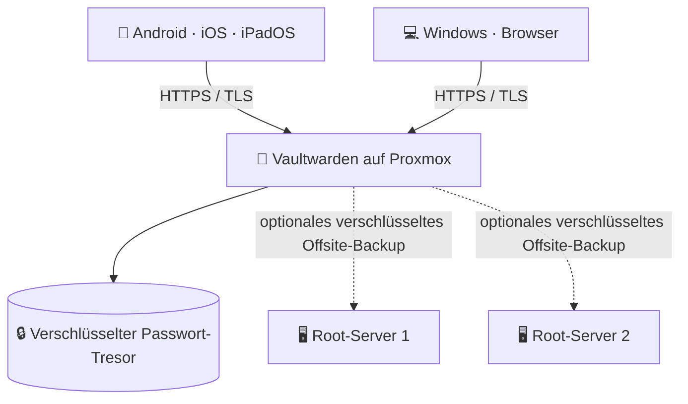

# 🔐 Mein Passwortmanager – Vaultwarden & Bitwarden

### Ein Passwort-Tresor für Android, iPhone, iPad, Windows und Browser

**Eigener Vaultwarden-Server auf Proxmox · Offizielle Bitwarden-Apps · Synchronisierung über HTTPS**

> **Du installierst auf deinem Handy Bitwarden – nicht Vaultwarden.** Vaultwarden läuft bereits auf dem eigenen Proxmox-Server und speichert deinen verschlüsselten Tresor.

---

## 📲 App herunterladen – QR-Code scannen

<table>
<tr><th align="center">🤖 Android – Google Play Store</th><th align="center">🍎 iPhone / iPad – Apple App Store</th></tr>
<tr>
<td align="center" width="50%">
 
<strong>QR-Code mit der Handykamera scannen</strong>  
<a href="https://play.google.com/store/apps/details?id=com.x8bit.bitwarden">▶ Bitwarden im Google Play Store öffnen</a>
</td>
<td align="center" width="50%">
 
<strong>QR-Code mit der iPhone-Kamera scannen</strong>  
<a href="https://apps.apple.com/de/app/bitwarden-passwortmanager/id1137397744">▶ Bitwarden im Apple App Store öffnen</a>
</td>
</tr>
</table>

> QR-Codes sind **echte PNGs mit transparentem Alphakanal** und liegen direkt unter `images/` in diesem GitHub-Projekt. Die Codes verweisen **nur auf die offiziellen Store-Einträge**, nicht auf einen unbekannten Download.

---

## 🗺️ So funktioniert dein Passwortmanager

> **Wichtig:** Backups auf Root-Servern sind keine Live-Synchronisierung zwischen mehreren aktiven Vaultwarden-Servern. Alle Apps verwenden **dieselbe aktive Server-URL**.

## ✅ Vor der persönlichen Einrichtung

- [ ] Dein Vaultwarden-Server ist eingeschaltet und über eine **gültige HTTPS-Adresse** erreichbar (z. B. `https://passwort.example.de`). **Ersetze die Beispieldomain durch deine echte Adresse.**
- [ ] Du kennst deine persönliche **E-Mail-Adresse** für den Tresor.
- [ ] Du hast ein **langes, einzigartiges Masterpasswort** vorbereitet (z. B. eine lange, zufällige Passphrase).
- [ ] Die Registrierung neuer Benutzer ist auf dem Server vorübergehend freigeschaltet **oder** dein Benutzerkonto wurde bereits angelegt.
- [ ] Falls du von außerhalb deines Heimnetzes zugreifen möchtest, funktioniert die HTTPS-Adresse auch über Mobilfunk (oder du nutzt einen entsprechend eingerichteten VPN-Zugang).

**Nicht verwechseln:** Der `/admin`-Token des Servers ist **kein persönliches Benutzerpasswort** und gehört niemals in die Handy-App.

---

## 🚀 Schritt für Schritt – Android und iOS

<table>
<tr><th>Schritt</th><th>Was du machst</th></tr>
<tr><td align="center"><strong>01</strong> 📥</td><td>Installiere die <strong>offizielle Bitwarden Passwortmanager</strong>-App über den QR-Code oben.</td></tr>
<tr><td align="center"><strong>02</strong> ⚙️</td><td>Öffne Bitwarden. <strong>Vor dem Anmelden</strong> wählst du in der Server- bzw. Regionsauswahl <strong>„Selbst gehostet / Self-hosted“</strong>. Die Schaltfläche kann je nach App-Version unterschiedlich heißen.</td></tr>
<tr><td align="center"><strong>03</strong> 🌐</td><td>Gib unter <strong>Server-URL</strong> deine eigene vollständige HTTPS-Adresse ein, z. B. <code>https://passwort.example.de</code>. <strong>Nicht</strong> <code>bitwarden.com</code> auswählen und <strong>nicht</strong> <code>/admin</code> an die URL anhängen.</td></tr>
<tr><td align="center"><strong>04</strong> 👤</td><td>Mit einem bereits vorhandenen Vaultwarden-Konto anmelden. Bei Erstnutzung zunächst auf deinem eigenen Server ein Benutzerkonto erstellen (nur während Registrierungen erlaubt sind).</td></tr>
<tr><td align="center"><strong>05</strong> 🔑</td><td>Masterpasswort eingeben und die erste Synchronisierung abwarten. Benutze <strong>das gleiche Konto auf allen Geräten</strong>.</td></tr>
<tr><td align="center"><strong>06</strong> 🛡️</td><td>In den Tresor-Einstellungen <strong>Zwei-Faktor-Authentifizierung</strong> aktivieren und den Wiederherstellungscode sicher <strong>außerhalb des Tresors</strong> aufbewahren.</td></tr>
<tr><td align="center"><strong>07</strong> 🔄</td><td>Lege einen Testeintrag an und öffne ihn auf dem zweiten Gerät. Damit prüfst du die Synchronisierung.</td></tr>
</table>

### 🤖 Android – automatisches Ausfüllen einrichten

1. Bitwarden öffnen → **Einstellungen → AutoFill / Automatisches Ausfüllen**.
2. Den von Bitwarden angebotenen Android-Autofill-Dienst aktivieren; die angezeigte Systemfreigabe bestätigen.
3. Optional **biometrisches Entsperren** (Fingerabdruck/Gesichtserkennung) aktivieren.
4. In einer App oder auf einer Webseite testen, ob Bitwarden einen passenden Login vorschlägt.

Auf einzelnen Android-Oberflächen findest du die Systemauswahl auch unter **Einstellungen → Passwörter, Passkeys und Konten / Bevorzugter Dienst**. Namen und Menüpfade können sich durch Android-/Hersteller-Updates ändern.

### 🍎 iPhone / iPad – automatisches Ausfüllen einrichten

1. In Bitwarden **Face ID bzw. Touch ID** aktivieren, falls unterstützt.
2. Öffne die **iOS-Einstellungen** und suche nach **„Automatisch ausfüllen“** bzw. **„Passwörter & Codes“**.
3. Aktiviere das Ausfüllen von Passwörtern/Passkeys und wähle **Bitwarden** als Anbieter.
4. Teste die Anmeldung in Safari oder einer App.

> Auf iOS können die Schalter je nach iOS-Version leicht anders heißen. Folge im Zweifel den Hinweisen direkt in der Bitwarden-App.

---

## 💻 Windows und Browser

| Gerät / Browser | Offizieller Einstieg |
|---|---|
| Windows / macOS / Linux | [Bitwarden Desktop-Downloads](https://bitwarden.com/download/) |
| Google Chrome | [Browser-Erweiterungen bei Bitwarden](https://bitwarden.com/download/) |
| Microsoft Edge | [Browser-Erweiterungen bei Bitwarden](https://bitwarden.com/download/) |
| Firefox | [Browser-Erweiterungen bei Bitwarden](https://bitwarden.com/download/) |

**Wichtig:** Auch in der Desktop-App und Browser-Erweiterung vor der Anmeldung die **selbst gehostete Server-URL** auswählen. Die Browser-Erweiterung hilft beim Speichern und automatischen Ausfüllen von Logins.

---

## 🧾 Erstes Passwort speichern

1. In Bitwarden auf **Neuer Eintrag / +** tippen.
2. Typ **Login** auswählen.
3. Namen, Benutzernamen, Passwort und die **korrekte Website-URL** eintragen.
4. **Speichern** und auf dem zweiten Gerät synchronisieren.
5. Für neue Konten ein **eigenes zufällig generiertes Passwort** verwenden – keine Passwörter wiederverwenden.

### 📦 Umzug von PWSafe / Password Safe

1. Altes Passwortprogramm zunächst **nicht löschen**.
2. Prüfen, welches Exportformat deine konkrete PWSafe-Version anbietet (z. B. CSV oder XML).
3. Falls erforderlich, die Daten **nur lokal und vertrauenswürdig** in ein von Bitwarden unterstütztes Importformat umwandeln.
4. Import **nur über deinen eigenen Vaultwarden-Webtresor**, mit zuvor verifizierter HTTPS-Adresse, durchführen.
5. Stichprobenartig Einträge, URLs und Sonderzeichen prüfen.
6. Unverschlüsselte Exportdateien anschließend entfernen. Die bisherige **verschlüsselte** PWSafe-Datenbank vorerst als Rückfalloption behalten.

**Achtung:** Ein Importformat wird nicht automatisch von jeder PWSafe-App unterstützt. Es hängt von der genauen verwendeten Software ab.

---

## 🛡️ Sicherheit nach der ersten Anmeldung

| Maßnahme | Empfehlung |
|---|---|
| Masterpasswort | Sehr lang, einzigartig und sicher offline wiederherstellbar |
| Zwei-Faktor-Authentifizierung | Aktivieren; Wiederherstellungscode separat sichern |
| Biometrie | Optional als komfortable lokale Entsperrung |
| Auto-Sperre | Bei Gerätesperre bzw. nach kurzer Inaktivität |
| HTTPS | Pflicht für die Serververbindung |
| Registrierungen | **Nach dem Anlegen der gewünschten Konten deaktivieren** |
| Server-Adminzugriff | Separat absichern und nicht mit dem Benutzertresor verwechseln |
| Offsite-Backups | Überprüfen, ob Backups wirklich laufen und testweise wiederherstellbar sind |

> ⚠️ **Stand des Proxmox-Installers:** Die bestehende Vaultwarden-Compose-Vorlage enthält standardmäßig `SIGNUPS_ALLOWED: "true"`. Dies muss nach der Kontoanlage bewusst deaktiviert und der Container entsprechend neu bereitgestellt werden. Die Dokumentation allein verändert diese Einstellung nicht.

---

<strong>❓ Häufige Probleme und Lösungen</strong>

**„Benutzer nicht gefunden“ oder Anmeldung klappt nicht**

Prüfe zuerst, ob die Bitwarden-App auf **„Selbst gehostet“** eingestellt ist und dieselbe Server-URL wie der Webtresor verwendet. Bitwarden-Cloud-Konten sind nicht automatisch Konten auf deinem Vaultwarden-Server.

**„Server nicht erreichbar“**

Prüfe HTTPS-Zertifikat, DNS, Reverse Proxy sowie die Erreichbarkeit über WLAN und Mobilfunk. Selbstsignierte oder nicht vertrauenswürdige Zertifikate können mobile Apps blockieren.

**„Registrierung deaktiviert“**

Dies ist nach Abschluss der Ersteinrichtung erwünscht. Weitere Benutzer müssen vom Betreiber kontrolliert zugelassen werden.

**„Keine Passwörter auf dem zweiten Gerät“**

Prüfe die Anmeldung mit derselben E-Mail und derselben Server-URL. Danach manuell synchronisieren und die Netzwerkverbindung prüfen.

**„Ich habe das Masterpasswort vergessen“**

Ein selbst gehosteter Dienst kann dein Masterpasswort nicht einfach entschlüsseln. Sichere Wiederherstellungsmethoden und Backups deshalb **vorher** planen.

## 📚 Weiterführende Anleitungen

- 🧰 [Vaultwarden auf Proxmox installieren](../proxmox.sh)
- 🗄️ [Verschlüsselte Backups auf Root-Servern einrichten](../VAULTWARDEN-BACKUP.md)
- 🌐 [Bitwarden: Offizielle Anleitung für eigene Server-URLs](https://bitwarden.com/de-de/help/change-client-environment/)
- 📲 [Bitwarden: Offizielle App-Downloads](https://bitwarden.com/download/)
- 🏠 [Vaultwarden: Quellcode und Releases](https://github.com/dani-garcia/vaultwarden)

---

Dokumentation für das GitHub-Projekt <strong>Technox90/homeatic</strong> · Stand: November 2026 · Keine Passwörter, Tokens oder privaten Schlüssel in GitHub speichern.

